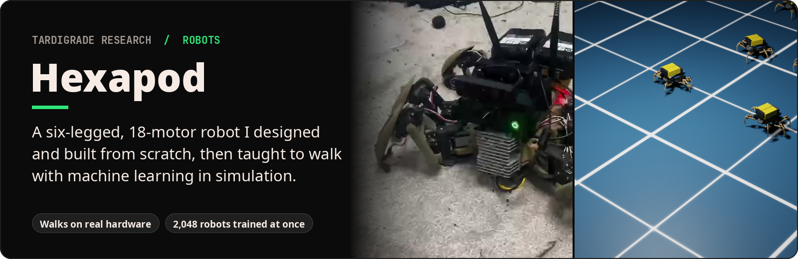
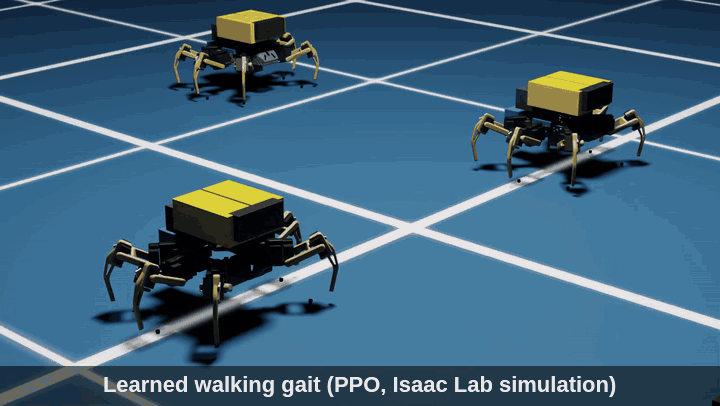
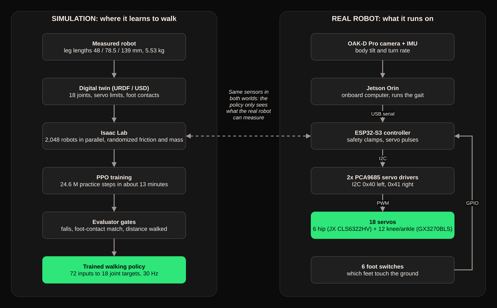

**What it is.** An 18-motor, 3D-printed hexapod robot (6 legs, 3 joints each) that I designed and built, plus the simulator setup used to train its walking brain.

**What it does.** A neural network practises walking millions of times in a physics simulator (NVIDIA Isaac Lab) and learns its own gait, using only the sensors the real robot carries. The real robot walks today with a programmed tripod gait.

**Why it matters.** This is the same train-in-simulation approach research labs use for legged robots, done end to end by one person: CAD, printing, wiring, firmware, simulation and training.

| The real robot walking | The build | Learning in Isaac Sim |
|---|---|---|
|  |  |  |
| Walking build, scripted tripod gait ([full clip](media/build-evolution/04-first-walking-build/physical-scripted-walk-demo.mp4)) | Second build: printed frame and custom legs | Early training run in Isaac Sim (click to play) |

## Highlights

| | |
|---|---|
| **2,048** robots trained in parallel | **24.6 M** practice steps in about **13 minutes** |
| **0 falls** in the fixed-speed evaluations | **0.27 m/s** top simulated walking speed |
| **97%** foot-contact match with the target gait | **72** sensor inputs, all available on the real robot |

Full numbers: [docs/results.md](docs/results.md).

## How it works

The robot was measured (leg lengths, mass, servo limits) and rebuilt as a digital twin. Isaac Lab runs thousands of copies of it at once, each with randomized floor friction and body mass, and PPO (a reinforcement-learning algorithm) rewards the copies that walk well. The policy only sees what the real robot can sense: body tilt and turn rate from the IMU, its own previous commands, the gait clock and the six foot switches. Diagram source: [docs/diagrams/architecture.drawio](docs/diagrams/architecture.drawio).

## Bill of materials

Parts as used on the walking build, all bought on Amazon. Prices are approximate 2026 street prices in USD. Parts marked "(or equivalent)" are representative listings that match the spec of the part used; any listing with the same spec will do. Items marked "Recommended" are standard choices where the original build's exact value wasn't recorded.

### Motion

| Part | Qty | Spec | Approx. cost |
|---|---|---|---|
| Hip (coxa) servo: [JX CLS6322HV](https://servodatabase.com/servo/jx-servo/cls6322hv) | 6 | HV coreless, 2.07 N·m at 7.4 V, 120° variant | ~$40–46 each |
| Knee and ankle servo: [Yipin GX3270BLS](https://rccrawlers.net/2025/05/14/yipin_70kg_2505/) | 12 | 70 kg-class brushless HV, 25T spline, 270° variant, 0.10 s/60° at 7.4 V | ~$35–70 each |
| Servo arms, 25T (knee and ankle) | 12 | The aluminium 25T arm supplied with each GX3270BLS. Femur pocket: Ø16.2 mm hub, 12.6 → 7.6 mm taper, 4.4 mm deep | included with the servo |
| Servo arms (hip): [Hobbypark 25T aluminium servo arm, 5-pack](https://www.amazon.com/Hobbypark-Aluminum-Standard-Torque-Motors/dp/B06XQ2SRGC) (or equivalent) | 6 | 25T clamping aluminium arm, M3 holes, to fit the CLS6322HV's 25T spline | ~$10–13 per 5-pack (2 packs) |

### Control and sensing

| Part | Qty | Spec | Approx. cost |
|---|---|---|---|
| [ESP32-S3](https://www.espressif.com/en/products/socs/esp32-s3) dev board | 1 | Dual-core, native USB; mounted on a screw-terminal breakout | ~$15 |
| PCA9685 16-channel servo driver ([Adafruit 815](https://www.adafruit.com/product/815)) | 2 | I2C, 50 Hz; addresses 0x40 (left) and 0x41 (right, A0 bridged) | ~$6–10 each |
| Foot-contact switch: [KW12 hinge-lever micro switch, 10-pack](https://www.amazon.com/Antrader-10-Pack-KW12-KW11-Switches/dp/B07YQQ3R7W) (or equivalent) | 6 | SPDT micro switch, 3 terminals (COM / NO / NC), 5 A; wired COM → GPIO, NO → GND, NC unused | ~$7–9 per 10-pack |
| [Luxonis OAK-D Pro](https://uk.robotshop.com/products/luxonis-oak-d-pro-camera-fixed-focus) | 1 | Stereo depth camera with built-in IMU (the policy's tilt and turn-rate source) | ~$300–400 |
| [NVIDIA Jetson Orin Nano Super dev kit + Waveshare aluminium case](https://www.amazon.com/waveshare-Development-Embedded-Aluminum-Wireless/dp/B0FN773FFC) | 1 | Onboard computer: Jetson Orin Nano module, 8 GB LPDDR5 (or equivalent: any 8 GB Orin Nano dev kit plus a [Waveshare Orin case](https://www.amazon.com/Waveshare-Aluminum-Mini-Computer-Compatible-withJetson/dp/B0CG38BS5S)); powered at 12 V from the buck converter | ~$280–330 |

### Power

| Part | Qty | Spec | Approx. cost |
|---|---|---|---|
| 20 V tool battery (DeWalt-compatible, labelled DCB204) | 2 | 20 V, 8.0 Ah, 160 Wh Li-ion | ~$25–45 each (aftermarket) |
| Battery-to-wire adapter: [Power Wheels adapter for DeWalt 20 V, 2-pack](https://www.amazon.com/Adapter-Battery-Lithium-Convertor-Robotics/dp/B09J4R4QZ6) (or equivalent) | 2 | Clips onto a DeWalt-style 20 V pack; built-in switch, 30 A fuse, 12 AWG leads | ~$15–20 per 2-pack |
| BEC (servo rail): [Castle Creations CC BEC Pro 20A](https://www.amazon.com/Castle-Creations-Bec-Switching-Regulator/dp/B002ITEL42) | 2 | 20 A peak, about 13–15 A continuous at 20 V input, up to 12S input. Ships at 5.1 V; program to 7.4 V with a Castle Link USB adapter (~$25, buy one). Outputs kept separate, never paralleled | ~$45–55 each |
| Buck converter (Jetson supply): [24 V → 12 V 10 A step-down, 15–40 V input](https://www.amazon.com/Converter-Transformer-Waterproof-Voltage-Reducer/dp/B08YYKSRJW) (or equivalent) | 1 | Finned aluminium, potted module; 20 V pack in, 12 V out to the Jetson's DC barrel jack | ~$15–20 |

### Frame and hardware

| Part | Qty | Spec | Approx. cost |
|---|---|---|---|
| Upper and lower frame plates (printed) | 1 set | Remix of the [MakeYourPet hexapod](https://github.com/MakeYourPet/hexapod) (MIT): widened, elongated, angled coxa mounts. Chassis 271 mm long, ~151 cm³ of plastic | in filament |
| Coxa brackets (printed) | 6 | ~16 cm³ each | in filament |
| Femurs (printed, original design in Onshape) | 6 | 78.5 mm horn to horn, ~22 cm³ each | in filament |
| Tibias (printed, original design in Onshape) | 6 | 139 mm from ankle horn to floor, ~16 cm³ each | in filament |
| Foot tips (printed) | 6 | ~0.4 cm³ each | in filament |
| Filament: PLA / PLA Pro, PETG for flexing parts | ~0.3–0.6 kg | ~484 cm³ of parts in total; printed on a Bambu A1 | ~$20 per 1 kg spool |
| Heat-set inserts: [ruthex M3 × 5.7 mm brass, 100-pack](https://www.amazon.com/dp/B08BCRZZS3) (or equivalent) | as needed | M3 thread to match the M3 screws. Ankles and coxa mounts | ~$10–13 per 100 |
| M3 screws: [M3 socket-head assortment, 6–30 mm, with nuts and washers](https://www.amazon.com/Hex-Socket-Head-Screws-Assortment/dp/B0HKFCTLK8) (or equivalent) | as needed | Servo-arm tip screw is M3 (Ø3.2 mm clearance, 30 mm from the pivot). Recommended: M3 × 8–12 mm into the inserts, M3 × 16–20 mm through arm and femur; trim to your part thickness | ~$10–15 per kit |
| Epoxy putty: [J-B Weld SteelStik](https://www.amazon.com/J-B-Weld-8267-S-SteelStik-Reinforced/dp/B000786GLM) (or equivalent) | 1 | Hand-mixed steel-reinforced epoxy putty; fills and locks the coxa mounts around the inserts | ~$8–12 |

### Wiring

| Part | Qty | Spec |
|---|---|---|
| Servo extension leads: [300 mm JR/Futaba male-to-female](https://www.amazon.com/Aliotech-Remote-Control-Extension-Airplane/dp/B094FY11XQ) (or equivalent) | 18 | 22 AWG, plug-in connectors rather than solder splices, so parts can be swapped. Recommended length 300 mm; measure your routing. ~$12–15 for 18–20 |
| Servo power wire: [14 AWG silicone, red and black](https://www.amazon.com/BNTECHGO-Silicone-Flexible-Strands-Stranded/dp/B01AAX65ZK) (or equivalent) | as needed | At least as heavy as the servo leads. Recommended: 14 AWG from each BEC to its PCA9685 `V+`, about 30 cm per run; the battery side uses the adapters' 12 AWG leads. ~$15–18 |
| Foot-switch wire: [22 AWG 2-conductor stranded cable](https://www.amazon.com/Gauge-Conductor-Stranded-Security-Black/dp/B00JV67KYS) (or equivalent) | 6 runs | Recommended: 22 AWG stranded, about 40 cm per run from tibia to ESP32, strain-relieved at each joint. ~$10–12 |
| I2C and logic jumpers | ~10 | Dupont or screw terminal; 20 cm Dupont jumpers. ~$6–8 per pack |

**Optional voice add-on (used in the live demo):** a LavMicro lavalier mic and a BTS0011 Bluetooth speaker on the Jetson, for offline voice commands ("stand", "salute", "down").

Everything above comes to roughly **$1,575–2,325**, including the Jetson (about $280–330) and the Castle Link adapter. Without the Jetson it is roughly $1,300–2,000. The printer and the optional voice add-on are not included.

## Build it yourself

*Where it started: hand-cut aluminium brackets, hobby servos and power-tool batteries. Full history: [docs/build-evolution.md](docs/build-evolution.md).*

### 1. Print

Print the frame plates from the [MakeYourPet hexapod](https://github.com/MakeYourPet/hexapod) and widen them to suit your servos. Model your femurs and tibias to the measured lengths (coxa 48 mm, femur 78.5 mm, tibia 139 mm) so the simulator's numbers match your robot. Prototype in PLA, and use PETG where a part flexes or takes impacts.

Recommended print settings (the walking build was printed on a Bambu A1; record your own): 0.4 mm nozzle, 0.2 mm layers, 4–6 walls, 20–30% gyroid infill, with solid (100%) modifiers around heat-set insert holes, servo-arm pockets and other fastener areas. Dense global infill adds weight and warping without adding much strength; extra walls do more.

### 2. Assemble

1. Drill the femurs for the servo arms and test-fit them. Set heat-set inserts in the ankles and let them cool straight.
2. Pack the coxa mounts with epoxy putty, embed inserts, and keep servo and arm travel clear while it cures.
3. Centre every servo at 1500 µs **before** fitting its arm, and label each one by leg and joint.
4. Build one complete reference leg, move every joint by hand, fix any binding, then copy it five times.
5. Mount the legs to the chassis and sweep each one through its range by hand to check for collisions.
6. Fit a foot switch in each tibia so the toe presses it on contact and releases when lifted ([concept sketch](media/build-evolution/01-concept-sketches/concept-foot-contact-switch.jpg)).

### 3. Wire

- **I2C:** ESP32 GPIO1 = SDA, GPIO2 = SCL, shared by both PCA9685 boards. Bridge A0 on the right board so it answers at 0x41.
- **Servo power:** BEC output (7.4 V) into each PCA9685's `V+` terminal. Never feed 7.4 V into the board's logic `VCC`.
- **Common ground:** tie the battery, BEC, PCA9685 and ESP32 grounds together. If servos jump to random extremes, check this first.
- **Foot switches:** COM → GPIO, NO → GND, inputs set to `INPUT_PULLUP` (pressed reads LOW).

| Foot switch | Front | Middle | Rear |
|---|---|---|---|
| Left | GPIO7 | GPIO4 | GPIO6 |
| Right | GPIO16 | GPIO15 | GPIO17 |

| PCA9685 channel (front / middle / rear) | Coxa | Knee | Ankle |
|---|---|---|---|
| Left board, 0x40 | 15 / 11 / 7 | 14 / 10 / 5 | 13 / 9 / 4 |
| Right board, 0x41 | 15 / 11 / 7 | 14 / 10 / 6 | 13 / 9 / 5 |

Check polarity with a meter before connecting any servo, and use connectors rather than solder splices on anything you may need to replace.

### 4. Flash

The ESP32-S3 firmware is an Arduino sketch built with `arduino-cli` (board `esp32:esp32:esp32s3:CDCOnBoot=cdc`, so serial works over native USB). It takes newline-terminated text commands at 115200 baud, holds a per-joint table (board, channel, direction, zero pulse, min and max angle) and clamps every command to that table before it reaches a servo. The geometry and limits it uses are in [src/ik_geometry.py](src/ik_geometry.py) and [config/servo_and_sim_limits.json](config/servo_and_sim_limits.json).

| Joint clamp | Min | Max | Zero |
|---|---|---|---|
| Coxa, front | 2° | 88° | 45° |
| Coxa, middle | 47° | 133° | 90° |
| Coxa, rear | 92° | 178° | 135° |
| Knee | 30° | 160° | 125° |
| Ankle | 55° | 150° | 68° |

Pulse window 620–2050 µs. These are the walking build's values; measure your own.

### 5. Calibrate

1. Put the robot on a stand with all six feet off the ground and the battery connector in reach (pulling it is the emergency stop).
2. Send all joints to 1500 µs. Zero pose: hip straight out, femur 35° above horizontal, knee interior angle 68°. Re-seat any arm that is off by a spline tooth.
3. Pulse one joint at a time by a few degrees (for example 1500 → 1530 → 1500 µs) and confirm the expected joint moved. Positive pulses should swing the hip forward, lift the knee and extend the ankle; mark any joint that moves the other way as inverted.
4. Record small per-joint trims (the walking build needed three).
5. Stand it: feet on a 185 mm radius from the body centre, 110 mm below the body.
6. Walk it: the scripted tripod gait uses an 18° stride, 42° lift and a 1.6–2.1 s period.

## Training and running the policy

1. **Install** [Isaac Sim and Isaac Lab](https://isaac-sim.github.io/IsaacLab/) on a machine with an NVIDIA RTX GPU (trained here on Isaac Sim 5.1).
2. **Build the digital twin:** a URDF with your measured segment lengths, joint limits, measured mass (5.53 kg here) and servo torque limits (2.07 N·m hips, 5.9 N·m knees and ankles).
3. **Match the real sensors:** use the 72-input observation in [src/deploy_observation_contract.py](src/deploy_observation_contract.py) (schema: [config/run63_deploy_observation_schema.json](config/run63_deploy_observation_schema.json)) with IMU noise and bias, one control step of actuator delay, and random foot-switch dropouts.
4. **Randomize the world:** floor friction 0.4–1.1, body mass ±10%, servo strength 65–100%.
5. **Train** with `rsl_rl` PPO through Isaac Lab's standard training script, headless, with 2,048 environments. The policy runs at 30 Hz and outputs 18 joint corrections on top of a scripted tripod-gait reference.
6. **Evaluate** each checkpoint at fixed speed commands for 8 s and keep it only with zero falls and a good foot-contact match ([src/stage1_gate_check.py](src/stage1_gate_check.py) shows the pattern).
7. **Run the policy** with Isaac Lab's matching `play` script to watch it walk, as in the clip at the top of this page ([full video](media/ari_run63_deploy_walk_0p25.mp4)).

## Repository layout

- `docs/`: [results](docs/results.md), [architecture](docs/architecture.md), [build evolution](docs/build-evolution.md), [draw.io diagram source](docs/diagrams/architecture.drawio)
- `src/`, `config/`: geometry and inverse kinematics, observation contract, evaluation gate, limits
- `evidence/metrics.json`: raw training and evaluation numbers
- `media/`: build photos, robot video and simulation renders
- `scripts/validate_public_repo.py`: checks the repo for secrets, local paths and oversized files

## Credits

- **Femurs and tibias:** original designs, modeled in Onshape.
- **Frame plates:** started from the open-source [MakeYourPet hexapod](https://github.com/MakeYourPet/hexapod) (MIT), then substantially reworked: widened, elongated, angled coxa mounts, new wall angles and reliefs for this hardware.
- Control, simulation setup, training and evaluation: original work.

## License

MIT, see [LICENSE](LICENSE). Citation metadata: [CITATION.cff](CITATION.cff).
