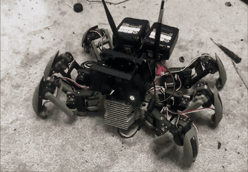
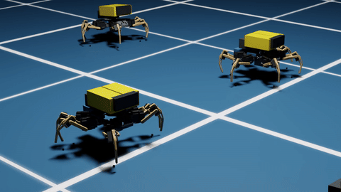
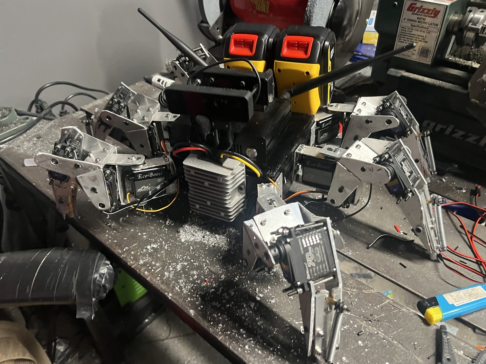
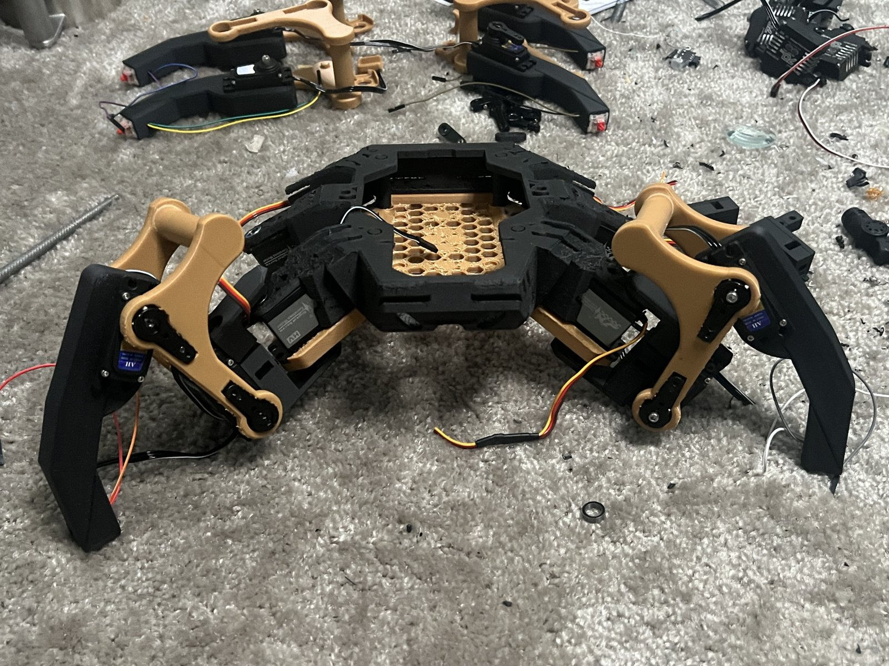

# hexapod-rl

An 18-DOF hexapod trained to walk in simulation with PPO in Isaac Lab. **Simulation-validated only: no learned policy has been transferred to the hardware.**

*Real robot (first build, MakeYourPet-derived frame), deterministic scripted gait.* Full clip: [physical-scripted-walk-demo.mp4](media/build-evolution/04-first-walking-build/physical-scripted-walk-demo.mp4)

| Learned policy in Isaac Sim | Training progress in Isaac Sim |
|---|---|
|  [full clip](media/ari_run63_deploy_walk_0p25.mp4) | [learning-to-walk-progress.mp4](media/build-evolution/05-learning-to-walk/learning-to-walk-progress.mp4) |

## Hardware

| Item | Detail |
|---|---|
| Legs / DOF | 6 legs, 3 joints each (coxa yaw, femur pitch, tibia pitch), 18 total |
| Controller | ESP32-class microcontroller driving hobby servos, with bounded joint targets |
| Sensing | Foot-contact switches; IMU-derived signals used as policy inputs in simulation |
| Structure | 3D-printed; see Provenance |
| Status | Scripted deterministic gait runs on the real robot |

## Training setup

- Simulator: Isaac Lab (articulation, contact sensors, joint limits, torque/velocity limits, randomized friction and mass).
- Algorithm: PPO, thousands of parallel environments (one campaign: 2,048 environments, 500 updates, about 24.6 M transitions).
- Observations are restricted to what the real robot could measure: angular rate and gravity direction, command, gait phase, previous action, commanded-target joint proxies, foot-contact bits. Privileged simulator state is not allowed into the policy.
- Candidate policies pass fixed-command evaluator gates (falls, contact match, displacement) before being promoted. Anything that fails a gate is recorded as not promoted.

## Results (simulation only)

- Run64: 0.2704 m/s measured on a 0.45 m/s command, zero falls, contact match 0.9488.
- Run104: 500-update continuation completed; update 100 selected, update 500 rejected (traded displacement for stability).
- Full tables and gates: [docs/results.md](docs/results.md), raw numbers: [evidence/metrics.json](evidence/metrics.json).

## What didn't work

- **No hardware transfer.** No learned policy is cleared for the robot; autonomous hardware motion is prohibited in this repo.
- **Axis bug.** Rendering the simulation exposed that the legacy evaluator counted displacement along -X as forward, while the robot's forward is +X. Runs 63, 64, 104 and 105 are therefore valid only as legacy-axis simulator results, not as forward walking. Retraining on the corrected axis is pending.
- Run105 (speed campaign): no candidate promoted.
- `stage1_safe_025`: 50 updates, forward replay moved about 0.00003 m against a 0.005 m gate. Not promoted.
- RunV4 Stage-2: the pipeline ran end to end, but the policy did not walk (about -0.00004 m against the same gate). Not promoted.

## Repository layout

- `docs/`: [architecture](docs/architecture.md), [results](docs/results.md), [engineering process](docs/engineering-process.md), [safety and limitations](docs/safety-and-limitations.md), [reproducibility](docs/reproducibility.md), [build evolution](docs/build-evolution.md)
- `src/`, `config/`: representative sanitized examples (IK geometry, observation contract, gate check, limits)
- `media/`: build photos and videos
- `scripts/validate_public_repo.py`: checks the repo for secrets, paths, identifiers and required sim-only language

This is a snapshot, not a full reproduction package: the Isaac Lab environment, full asset tree, checkpoints and firmware are not included.

## Hardware build

First prototype: hand-fabricated aluminum brackets, hobby servos, depth camera and power-tool batteries.

Current (second) hardware build, shown mid-assembly; it is not the earlier robot seen walking. The learned walking policy is validated in simulation only.

## Provenance and credits

- **Femurs and tibias:** original designs, modeled in Onshape.
- **Upper and lower frame plates:** started from the open-source [MakeYourPet hexapod](https://github.com/MakeYourPet/hexapod) (MIT), then substantially modified — widened, elongated, angled coxa mounts, reworked wall angles, and new reliefs for this build's hardware.
- No CAD or mesh files are distributed in this repo.
- Everything else (control, simulation setup, training, evaluation) is original work in this repo.

## License

MIT, see [LICENSE](LICENSE). Citation metadata: [CITATION.cff](CITATION.cff).

## How this was built
AI is used here as a tool to speed up implementation. I design the system and
define what "working" means. When issues are found, they're identified, and
ARI — my own agent system — fixes them against those checks.
