# Build Evolution

How the robot got from a pile of aluminium brackets to a printed, 18-servo walker.

## Timeline

### Aluminum prototype

The first attempt: hand-fabricated aluminum brackets, hobby servos, a depth camera and power-tool batteries.

### Concept sketches

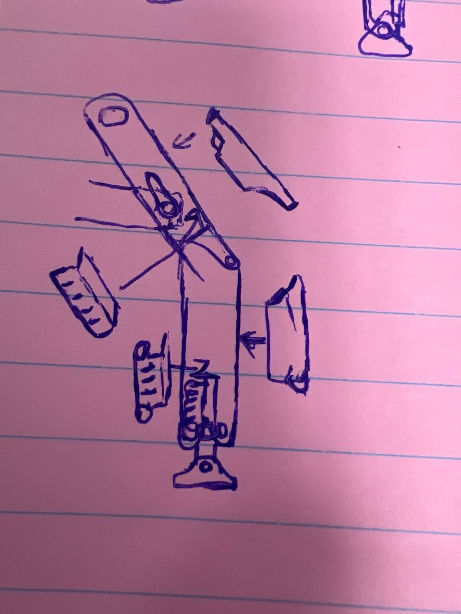

Early leg-assembly planning for an 18-DOF hexapod: six legs, three joints per leg, and a mechanical layout that could be fabricated and serviced.

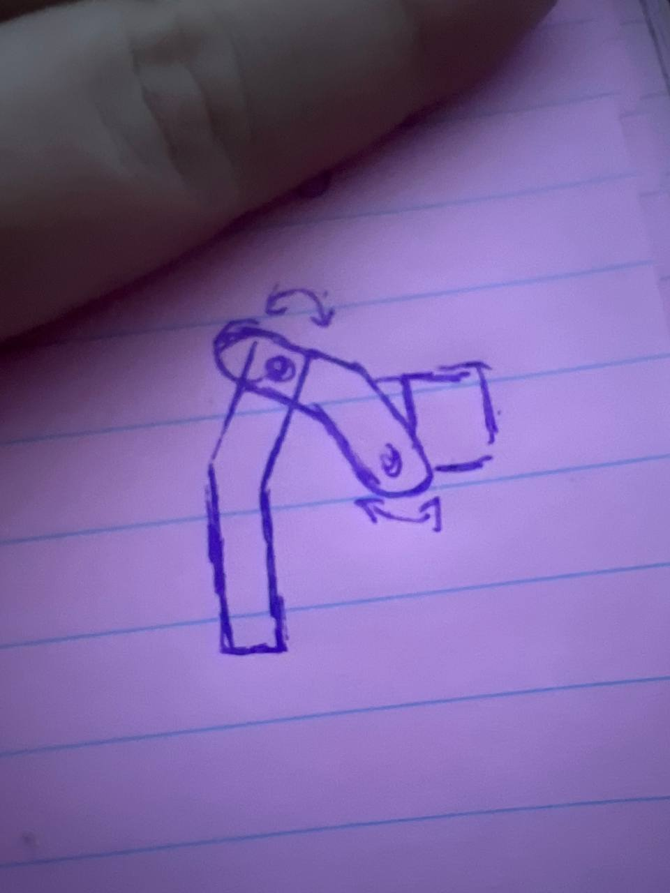

Linkage and joint-layout exploration before committing to the physical build.

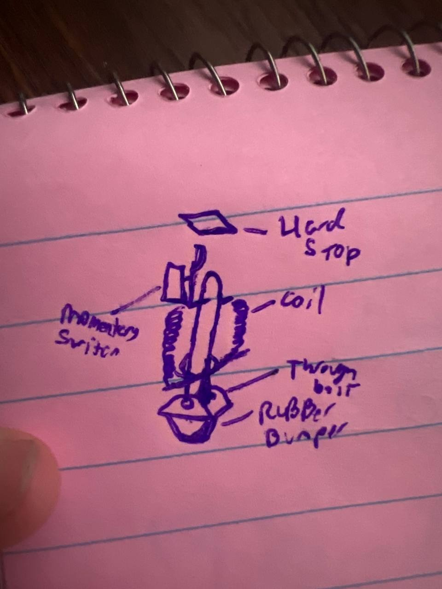

Foot-contact switch concept: a spring-loaded toe presses a switch when the foot touches the ground.

### Prototype 2

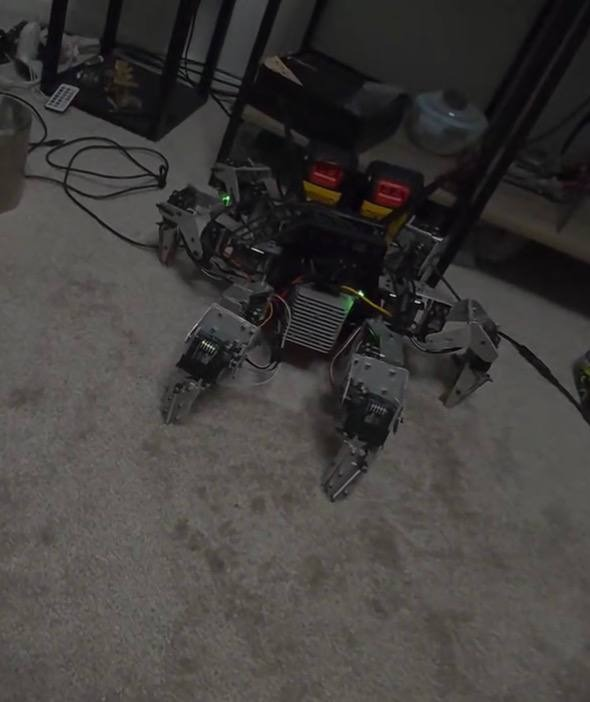

Prototype 2 brought the program from sketches into powered hardware: frame, servos, wiring, and control electronics arranged for bench testing.

### First walking build

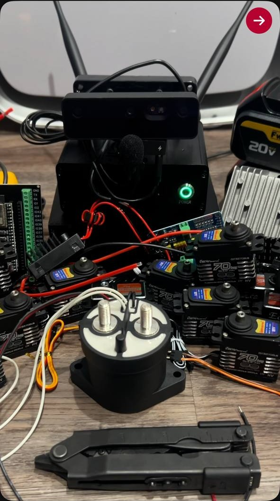

Servos, camera, batteries and electronics on the bench before assembly.

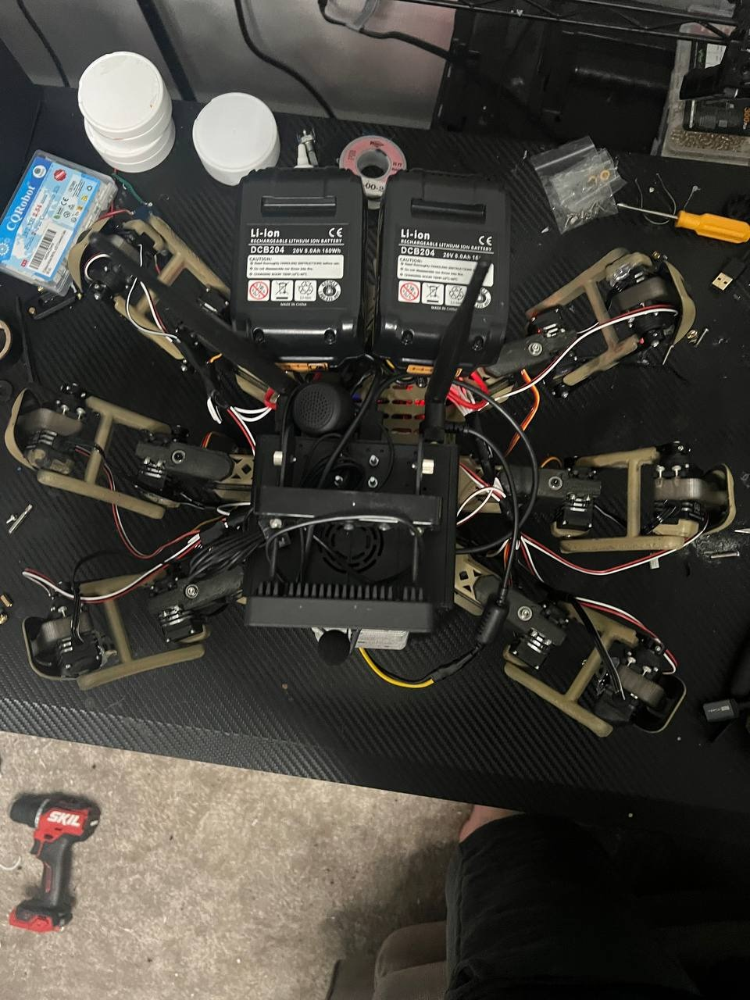

Top view: six legs, two 20 V battery packs and the onboard computer stacked on the chassis.

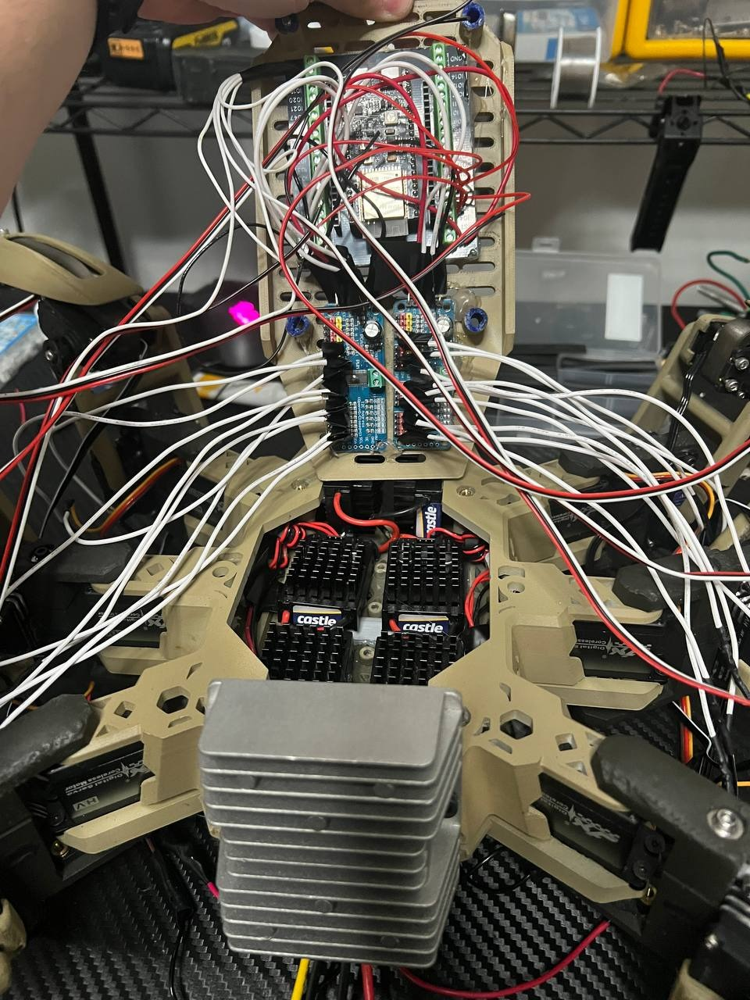

Power and control stack: ESP32-S3, two PCA9685 servo boards and two Castle BECs feeding the servo rail.

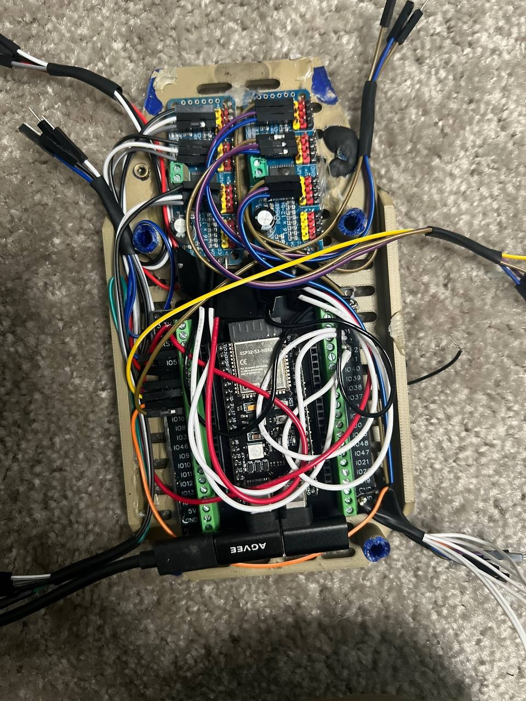

ESP32-S3 on a screw-terminal breakout, wired to the servo boards.

### Learning to walk (Isaac Sim)

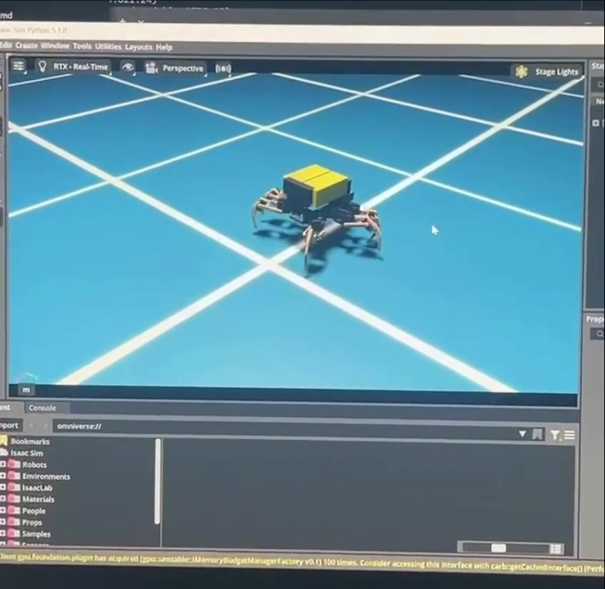

Early training run in Isaac Sim: [learning-to-walk-progress.mp4](../media/build-evolution/05-learning-to-walk/learning-to-walk-progress.mp4).

### Walking on real hardware

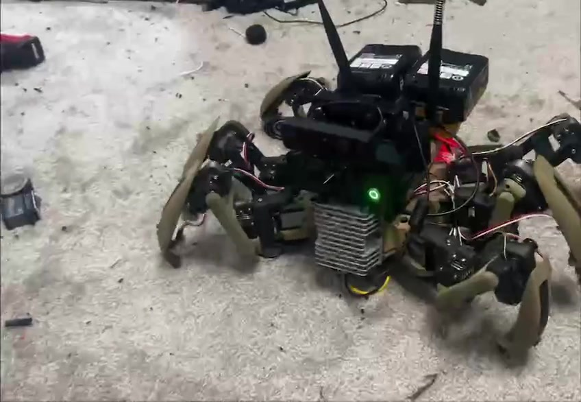

The first walking build on the floor with a scripted tripod gait: [physical-scripted-walk-demo.mp4](../media/build-evolution/04-first-walking-build/physical-scripted-walk-demo.mp4).

### Trained policy in Isaac Lab

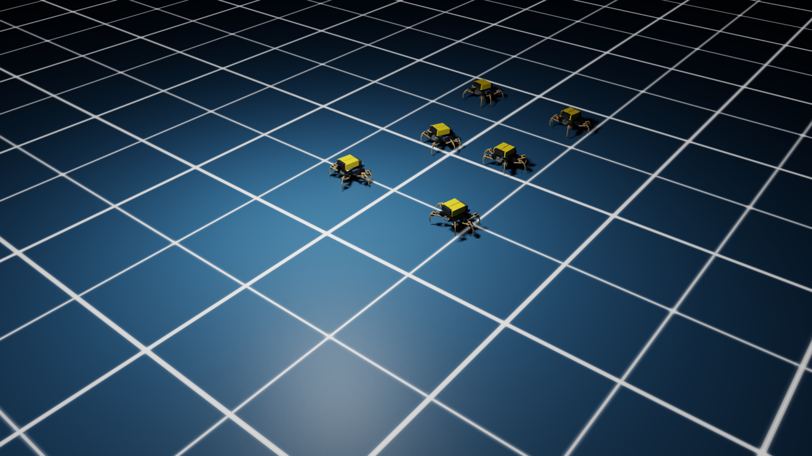

The Run63 policy, trained only on sensors the real robot has, walking at a 0.25 m/s command in six parallel environments: [ari_run63_deploy_walk_0p25.mp4](../media/ari_run63_deploy_walk_0p25.mp4).

### Second build

The second build: printed frame plates with new femurs and tibias designed in Onshape.
